  

# 🚀 Awesome Lightweight AI Coding Assistant

  
  
  
  
  
  

  <strong>🌟 Top Lightweight AI Coding Assistants, Fast Autocomplete Engines, Terminal-Based AI Agents & Minimalist IDE Plugins 🌟</strong>

  <em>A curated, SEO-optimized directory of lightning-fast, zero-bloat AI code assistants, offline local Fill-In-the-Middle (FIM) autocomplete models, terminal-first AI pair programmers, and lightweight Neovim/Emacs/VS Code extensions—comparing commercial hosted SaaS platforms against top-rated open-source alternatives.</em>

---

## 📑 Table of Contents

- [📊 Sector Overview & Market Dynamics](#-sector-overview--market-dynamics)
- [☁️ SaaS/Hosted Platforms](#️-saashosted-platforms)
- [🔓 Open-Source Equivalents & Tools](#-open-source-equivalents--tools)
  - [⚡ Lightweight Terminal & CLI AI Coding Agents](#-lightweight-terminal--cli-ai-coding-agents)
  - [🧩 Minimalist VS Code, JetBrains & Multi-IDE Extensions](#-minimalist-vs-code-jetbrains--multi-ide-extensions)
  - [📝 Neovim, Vim & Emacs Lightweight AI Plugins](#-neovim-vim--emacs-lightweight-ai-plugins)
  - [🏎️ Ultra-Fast Local Autocomplete & FIM Engines](#️-ultra-fast-local-autocomplete--fim-engines)
  - [💻 Open-Source AI-Native Lightweight Editors](#-open-source-ai-native-lightweight-editors)
- [📈 Star History](#-star-history)
- [💖 Support & Sponsorship](#-support--sponsorship)
- [🤝 Contributing](#-contributing)

---

## 📊 Sector Overview & Market Dynamics

The global AI coding assistant market is estimated between **$9.3B and $11.2B in 2026** (expanding rapidly from ~$4.2B–$8.5B in 2024–2025 at a ~25–32% CAGR). The sector exhibits a **hybrid market structure**: while the enterprise seat distribution and frontier infrastructure layer remain **heavily concentrated** among mega-cap tech giants and breakout AI labs (Microsoft/GitHub, Amazon, Alphabet, Anysphere/Cursor), the developer application layer and tooling interface form-factors are **moderately to highly fragmented** as terminal-based coding agents, specialized IDE plugins, and open-source local LLM engines continuously challenge traditional subscription copilot models.

---

## ☁️ SaaS/Hosted Platforms

Commercial, cloud-hosted AI coding assistants, proprietary IDE autocomplete engines, and managed developer copilot services.

| 🏢 Company / Product | 💰 Size (Valuation / Revenue) | 🏷️ Pricing (Starting Paid Tier) | 🎁 Free Tier / Trial Limits | 📝 Description |
| :--- | :--- | :--- | :--- | :--- |
| **[Amazon Q Developer](https://amazon.com)** | **~$2.1T+ Market Cap** (Amazon) | $19 / user / month (Pro) | **Free Forever**: 50 agentic requests/month, 50 security scans/month, and 1,000 LOC/month code transformations via AWS Builder ID. | AWS-managed generative AI coding assistant for inline code generation, security scanning, and cloud architecture guidance. |
| **[GitHub Copilot](https://github.com)** | **~$3.1T+ Market Cap** (Parent: Microsoft; GitHub ARR ~$2B+) | $10 / month (Copilot Pro) | **Free Forever**: 2,000 code completions/month and restricted basic Copilot Chat/agent allowances for individuals. | Industry-standard cloud AI pair programmer offering inline code completions, chat, and workspace agents across major IDEs. |
| **[Cursor](https://cursor.com)** | **~$29B Valuation** (Anysphere; ARR ~$1B+) | $20 / month (Pro) | **Free Forever (Hobby Plan)**: ~2,000 tab code completions/month, 50 slow requests, and limited access to native reasoning models. | Proprietary AI-native code editor built on VS Code featuring fast tab autocomplete, multi-file edits, and codebase indexing. |
| **[Sourcegraph Cody](https://sourcegraph.com)** | **$2.6B Valuation** ($223M+ funding raised) | Custom enterprise contract (Enterprise tier) | **14-Day Free Trial**: Self-serve free/pro tiers discontinued; enterprise evaluations offered via guided 14-day trials or custom POCs. | Commercial AI coding assistant leveraging deep multi-repository code graph context for accurate answers and edits. |
| **[Windsurf (Codeium)](https://codeium.com)** | **$1.25B Valuation** (ARR ~$40M–$82M; $243M raised; $2.4B Google IP/talent deal) | $20 / month (Pro) | **Free Forever**: Unlimited basic tab completions/inline edits, plus 25 monthly agentic action credits (Cascade flow). | Commercial agentic IDE and cloud autocomplete suite powered by Cascade flows and low-latency code prediction. |
| **[Codeium (Cloud Tier)](https://codeium.com)** | **$1.25B Valuation** (Parent: Exafunction/Codeium) | $20 / month (Pro) | **Free Forever (Individual Plan)**: Unlimited single- and multi-line code completions across 70+ languages and 40+ IDEs. | Cloud-hosted AI code completion and search extension supporting 70+ programming languages across 40+ editors. |
| **[JetBrains AI Assistant](https://jetbrains.com)** | **$700M–$800M+ Annual Revenue** (Bootstrapped / Private) | $10 / month (AI Pro) | **30-Day Free Trial** with full AI Pro credit pool; downgrades to **AI Free** with unlimited local completions (Mellum model) & restricted cloud chat credits. | Proprietary AI coding companion deeply integrated into IntelliJ, PyCharm, WebStorm, and GoLand. |
| **[Tabnine](https://tabnine.com)** | **~$50M ARR** ($55M+ raised; acquired by Tricentis) | $39 / user / month (Code Assistant) | **14-Day Free Trial**: Standalone perpetual free tier discontinued; offers full-featured 14-day trials of Code Assistant/Agentic Platform. | Privacy-focused commercial AI code assistant offering personalized autocomplete and enterprise VPC/on-premise deployment options. |
| **[Supermaven](https://supermaven.com)** | **~$50M–$100M Valuation** ($12M raised; acquired by Cursor/Anysphere) | $10 / month (Pro - standalone legacy) | **Free Forever**: Standalone tier provided fast inline completions with a reduced 300,000-token context window (core engine now merged into Cursor Tab). | Ultra-low-latency commercial code completion engine featuring a 1-million-token context window for rapid inline suggestions. |
| **[Continue.dev Hub](https://continue.dev)** | **$5.6M Venture Funding** (Acquired by Cursor/Anysphere) | $10 / developer / month (Team Hub - legacy) | **Free Forever (Solo Tier)**: Core client is free and uncapped with Bring-Your-Own-Key (BYOK) or local models (Ollama/llama.cpp); hosted Hub retired post-acquisition. | Hosted cloud platform by Continue for sharing, managing, and governing custom AI coding assistants and blocks across teams. |

---

## 🔓 Open-Source Equivalents & Tools

Free, open-source software (FOSS) lightweight coding agents, terminal pair programmers, local autocomplete engines, and zero-bloat editor plugins sorted by GitHub popularity.

### ⚡ Lightweight Terminal & CLI AI Coding Agents

* **[Open Interpreter](https://github.com/OpenInterpreter/open-interpreter)**  - Open-source, local-first code execution and terminal agent that lets language models run Python, Bash, JavaScript, and shell commands on your machine.
* **[Goose](https://github.com/block/goose)**  - Open-source, extensible on-machine AI developer agent from Block capable of autonomously editing multi-file projects, running terminal scripts, and connecting to Model Context Protocol (MCP) servers.
* **[Aider](https://github.com/paul-gauthier/aider)**  - High-speed terminal AI pair programmer that writes and edits code across multiple files in your local git repository with automated, descriptive git commits.
* **[Crush](https://github.com/charmbracelet/crush)**  - Glamorous, minimalist command-line AI assistant crafted in Go by Charm for fast inline explanations, shell script generation, and terminal workflows.
* **[Devika](https://github.com/stitionai/devika)**  - Open-source agentic software engineer capable of understanding high-level instructions, searching the web, planning, and autonomously writing source code.
* **[Plandex](https://github.com/plandex-ai/plandex)**  - Open-source terminal AI coding engine architected for large, multi-stage refactoring tasks with sandboxed diff tracking, version control, and rollback capability.
* **[LLM](https://github.com/simonw/llm)**  - Lightweight, modular CLI utility and Python library by Simon Willison for piping text, code snippets, and terminal logs into local or remote LLMs.
* **[ShellGPT (sgpt)](https://github.com/TheR1D/shell_gpt)**  - Clean, fast command-line AI assistant for generating shell commands, refactoring bash scripts, and querying code directly in your terminal.
* **[AIChat](https://github.com/sigoden/aichat)**  - All-in-one, ultra-lightweight CLI tool and REPL written in Rust supporting 20+ LLM providers, local RAG, shell execution, and custom roles.
* **[Nanocoder](https://github.com/Nano-Collective/nanocoder)**  - Minimalist, local-first CLI coding agent supporting multiple model endpoints, MCP tool integrations, and direct repository modifications with near-zero overhead.

---

### 🧩 Minimalist VS Code, JetBrains & Multi-IDE Extensions

* **[Cline](https://github.com/cline/cline)**  - Autonomous open-source AI coding assistant in VS Code that inspects project file trees, writes code, executes terminal commands, and requests approval for diffs.
* **[Continue](https://github.com/continuedev/continue)**  - Highly customizable, leading open-source AI coding extension for VS Code and JetBrains supporting custom tab autocomplete, chat, and local models via Ollama.
* **[Roo Code](https://github.com/RooCodeInc/Roo-Code)**  - Community-driven autonomous coding assistant with specialized prompt modes, custom tool auto-approvals, and fine-tuned local model support.
* **[Sweep](https://github.com/sweepai/sweep)**  - Open-source AI junior developer that turns GitHub issues into clean Pull Requests with automated testing, bug fixes, and refactoring.
* **[Twinny](https://github.com/rjmacarthy/twinny)**  - Privacy-focused, zero-telemetry AI code completion and chat extension for VS Code designed from the ground up for local inference via Ollama and llama.cpp.
* **[Refact.ai Core](https://github.com/smallcloudai/refact)**  - Self-hosted open-source AI code assistant architecture offering lightning-fast Fill-In-the-Middle (FIM) autocomplete, refactoring, and on-premise GPU support.

---

### 📝 Neovim, Vim & Emacs Lightweight AI Plugins

* **[Avante.nvim](https://github.com/yetone/avante.nvim)**  - Cursor-inspired AI coding environment for Neovim featuring side-by-side chat, inline diff applications, and fast token generation.
* **[CodeCompanion.nvim](https://github.com/olimorris/codecompanion.nvim)**  - Extensible, zero-bloat Neovim AI coding plugin with inline code generation, customizable agents, and native adapters for local and cloud models.
* **[gptel](https://github.com/karthink/gptel)**  - Clean, async LLM client for Emacs supporting multiple model backends (Ollama, llama.cpp, Claude, GPT) with zero external package dependencies.
* **[Minuet AI](https://github.com/milanglacier/minuet-ai.nvim)**  - Ultra-lightweight Neovim completion provider delivering low-latency, blink.cmp and nvim-cmp inline suggestions from local or remote LLMs.
* **[gp.nvim](https://github.com/Robitx/gp.nvim)**  - Minimalist Neovim plugin for chat conversations, inline code rewriting, and voice-to-code speech transcription without bloated dependencies.
* **[llm.nvim](https://github.com/huggingface/llm.nvim)**  - Official lightweight Neovim plugin by Hugging Face for fast Fill-In-the-Middle code completion using local or hosted inference endpoints.

---

### 🏎️ Ultra-Fast Local Autocomplete & FIM Engines

* **[Ollama](https://github.com/ollama/ollama)**  - Leading lightweight runner for local AI models, serving Qwen2.5-Coder, DeepSeek-Coder, and StarCoder with low latency across macOS, Linux, and Windows.
* **[llama.cpp](https://github.com/ggerganov/llama.cpp)**  - High-performance C/C++ LLM inference engine with zero dependencies, featuring native `/infill` server endpoints for sub-100ms IDE code autocomplete.
* **[Tabby](https://github.com/TabbyML/tabby)**  - Self-hosted, lightweight AI coding assistant written in Rust featuring blazing-fast Fill-In-the-Middle autocomplete and repository-wide context indexing.
* **[Qwen2.5-Coder](https://github.com/QwenLM/Qwen2.5-Coder)**  - Premier open-weights coding foundation model series (0.5B to 32B parameters) optimized for high-speed local inference and precise code generation.
* **[FauxPilot](https://github.com/fauxpilot/fauxpilot)**  - Open-source, self-hosted backend that replicates the GitHub Copilot API using local LLMs on NVIDIA GPUs for seamless editor integration.
* **[CodeGeeX4](https://github.com/THUDM/CodeGeeX4)**  - Multilingual open-weights code generation model optimized for low-resource local deployment and fast IDE completion plugins.

---

### 💻 Open-Source AI-Native Lightweight Editors

* **[Zed](https://github.com/zed-industries/zed)**  - Blazing-fast, GPU-accelerated code editor written in Rust with native inline AI completions, agentic sidebars, and local Ollama support.
* **[Void](https://github.com/voideditor/void)**  - Open-source alternative to Cursor built on VS Code, providing complete privacy, zero telemetry, and direct support for both local and cloud LLMs.
* **[Melty](https://github.com/meltylabs/melty)**  - Lightweight open-source AI code editor that tracks every keystroke and AI generation directly into clean Git commits for transparent review.

---

## 📈 Star History

---

## 💖 Support & Sponsorship

Thank you for exploring this curated collection of lightweight AI coding tools! If this repository has helped streamline your developer workflow, saved memory on your workstation, or accelerated your coding speed:

- 🌟 **Star this repository** on GitHub to help other developers discover lightweight AI tools.
- 🍴 **Fork and share** the project with your team and coding communities.
- ☕ **Buy me a coffee & support ongoing curation**: Consider sponsoring the project via the **[GitHub Sponsors Dashboard](https://github.com/sponsors/ishandutta2007)**.

Your sponsorship helps keep this directory continuously tested, up-to-date, and free of bloat!

---

## 🤝 Contributing

Contributions are warmly welcomed! If you have built or discovered an outstanding lightweight open-source coding assistant, terminal pair programmer, or local FIM engine:

1. 🍴 Fork the repository.
2. 🌿 Create a descriptive feature branch (`git checkout -b add-my-tool`).
3. ✍️ Add your project under the matching category with a concise, neutral description and proper repository link.
4. 🚀 Submit a Pull Request with details about why the tool fits the lightweight philosophy.
